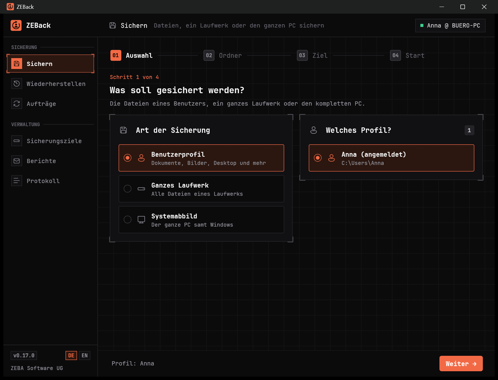
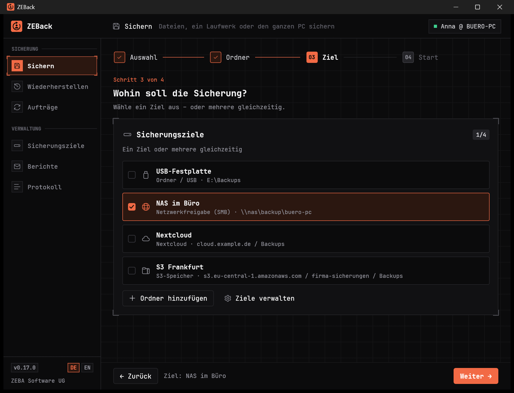
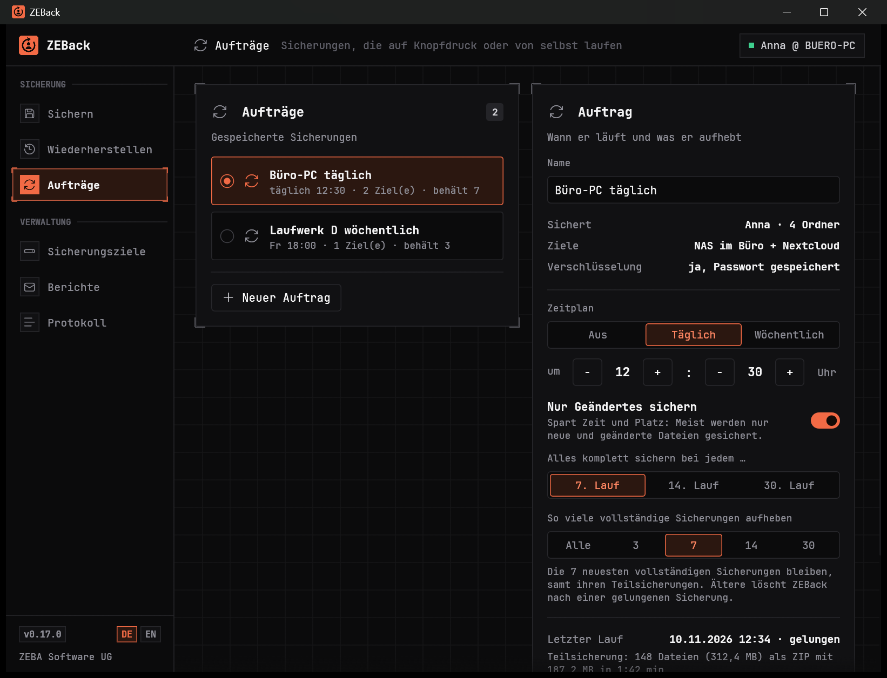
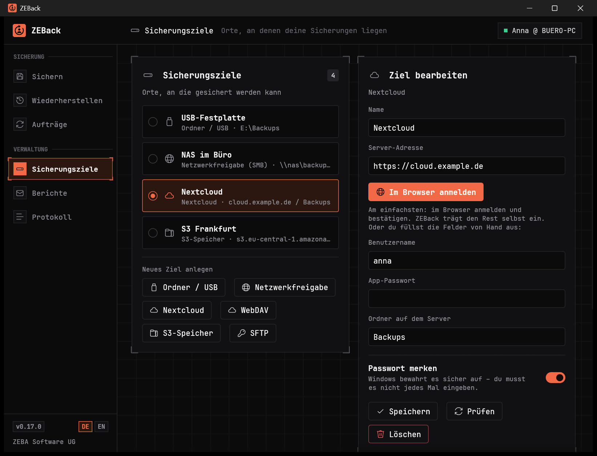
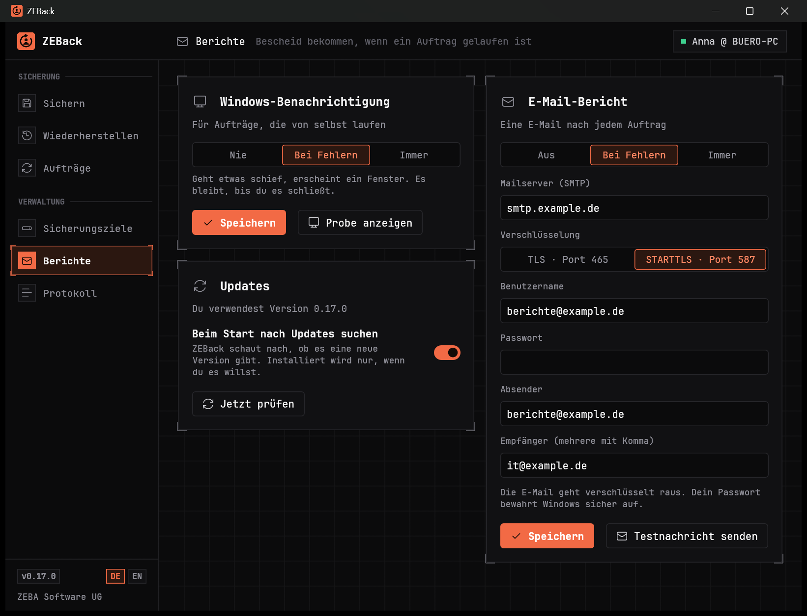

<h1 align="center">ZEBack</h1>

<p align="center">
  <b>Sichern und Wiederherstellen für Windows – Schritt für Schritt, ohne Vorkenntnisse.</b><br>
  Benutzerprofile, ganze Laufwerke und komplette Systeme. Auf USB, ins Netzwerk oder in die Cloud.
</p>

<p align="center">
  <a href="https://github.com/ZEBA-Software/ZEBack/releases/latest"><b>⬇ Neueste Version herunterladen</b></a>
  &nbsp;·&nbsp;
  <a href="#erste-schritte">Erste Schritte</a>
  &nbsp;·&nbsp;
  <a href="#häufige-fragen">Häufige Fragen</a>
  &nbsp;·&nbsp;
  <a href="#english">English</a>
</p>

<p align="center">
  
</p>

---

## Herunterladen

Alle Dateien liegen auf der Seite **[Neueste Version](https://github.com/ZEBA-Software/ZEBack/releases/latest)**.

| Du möchtest … | Nimm diese Datei |
|---|---|
| ZEBack ganz normal installieren (empfohlen) | `ZEBack-<Version>-x64.msi` |
| ZEBack ohne Installation starten, z. B. vom USB-Stick | [`ZEBack-x64.exe`](https://github.com/ZEBA-Software/ZEBack/releases/latest/download/ZEBack-x64.exe) |
| ein Gerät mit ARM-Prozessor nutzen (z. B. Surface mit Snapdragon) | `ZEBack-<Version>-arm64.msi` oder [`ZEBack-arm64.exe`](https://github.com/ZEBA-Software/ZEBack/releases/latest/download/ZEBack-arm64.exe) |

Unsicher, welcher Prozessor? Die **x64**-Fassung läuft auf fast jedem PC.

> **Windows warnt beim ersten Start?** Die Dateien sind noch nicht digital signiert. Erscheint
> „Der Computer wurde durch Windows geschützt“, klicke auf **Weitere Informationen** und dann auf
> **Trotzdem ausführen**.

ZEBack ist für Windows 10 und 11 gemacht. Updates holt sich das Programm auf Wunsch selbst: Es
meldet eine neue Version und installiert sie mit einem Klick.

## Was ZEBack kann

**Sichern**

- **Benutzerprofil** – Desktop, Dokumente, Bilder und Co., dazu Browser, Mail und Office-Vorlagen
- **Ganzes Laufwerk** – alle Dateien eines Laufwerks in einer ZIP-Datei
- **Systemabbild** – ein startfähiges Abbild von Windows, um einen PC komplett zurückzuholen
- **Verschlüsselt** mit AES-256, wenn du möchtest – und nach dem Sichern automatisch **geprüft**

**Wohin** – ein Ziel oder mehrere gleichzeitig

- USB-Stick, externe Festplatte oder ein Ordner
- Netzwerkfreigabe (NAS, Server)
- Nextcloud, WebDAV, S3-Speicher, SFTP

**Automatisch**

- **Aufträge** merken sich, was wohin gesichert wird, und laufen mit einem Klick oder nach **Zeitplan**
- **Nur Geändertes sichern** spart Zeit und Platz
- Alte Sicherungen werden auf Wunsch **aufgeräumt**
- **Berichte** per E-Mail oder Windows-Benachrichtigung, wenn etwas schiefgeht
- Läuft **im Hintergrund** weiter: Das Fenster lässt sich während einer Sicherung neben die Uhr
  ausblenden, ohne dass sie abbricht

**Wiederherstellen**

- in dein Benutzerprofil oder einen Ordner deiner Wahl
- ganze Ordner oder **einzelne Dateien**
- ZEBack findet deine Sicherungen auf allen Zielen von selbst

Sicherungen von Profilen und Laufwerken sind gewöhnliche ZIP-Dateien. Du kommst also auch ohne
ZEBack an deine Daten.

## Erste Schritte

1. **ZEBack starten** und links **Sichern** wählen.
2. **Auswählen, was gesichert wird** – dein Benutzerprofil ist schon vorgeschlagen.
3. **Ziel angeben** – zum Beispiel einen Ordner auf einer USB-Festplatte.
4. **Backup starten.** ZEBack zeigt, wie weit es ist, wie schnell es geht und wie lange es noch dauert.

Das Fenster darf dabei klein sein: Die Oberfläche passt sich an, in schmalen Fenstern rückt alles
in eine Spalte.

Soll das künftig von selbst laufen? Im letzten Schritt **Als Auftrag speichern** wählen und unter
**Aufträge** einen Zeitplan einstellen.

## Einblicke

| | |
|---|---|
| <br><sub><b>Ziel wählen</b> – eines oder mehrere gleichzeitig</sub> | <br><sub><b>Aufträge</b> – Zeitplan, Teilsicherungen, Aufbewahrung</sub> |
| <br><sub><b>Sicherungsziele</b> – hier eine Nextcloud mit Anmeldung im Browser</sub> | <br><sub><b>Berichte und Updates</b> – Bescheid bekommen, wenn etwas ist</sub> |

## Häufige Fragen

<details>
<summary><b>Wo liegen meine Passwörter?</b></summary>

Ausschließlich in der Anmeldeinformationsverwaltung von Windows – nie in einer Datei. Das Passwort
einer verschlüsselten Sicherung wird gar nicht gespeichert, außer du legst einen Auftrag an, der
ohne Nachfrage laufen soll.
</details>

<details>
<summary><b>Was ist, wenn ich das Passwort einer verschlüsselten Sicherung vergesse?</b></summary>

Dann ist die Sicherung nicht mehr lesbar – auch nicht für uns. Bewahre das Passwort getrennt von
der Sicherung auf.
</details>

<details>
<summary><b>Wie spiele ich ein Systemabbild zurück?</b></summary>

Ein Systemabbild wird außerhalb des laufenden Windows zurückgespielt, über die
Wiederherstellungsumgebung von Windows. ZEBack erklärt die Schritte unter <b>Wiederherstellen</b>
und hilft beim Erstellen eines Rettungs-USB-Sticks.
</details>

<details>
<summary><b>Warum dauert ein Systemabbild so lange?</b></summary>

Es enthält das komplette Laufwerk. Über WLAN auf ein Netzlaufwerk kann das Stunden dauern; per
Netzwerkkabel oder auf eine USB-3-Festplatte geht es deutlich schneller. Für den Alltag genügt meist
ein Auftrag für das Benutzerprofil mit „Nur Geändertes sichern“.
</details>

<details>
<summary><b>Was bedeutet „Nur Geändertes sichern“?</b></summary>

Nach einer vollständigen Sicherung packt der Auftrag nur noch neue und geänderte Dateien in kleine
Teilsicherungen. In regelmäßigen Abständen entsteht wieder eine Vollsicherung. Beim Wiederherstellen
führt ZEBack Voll- und Teilsicherungen von selbst zusammen.
</details>

<details>
<summary><b>Gibt es ZEBack auf Englisch?</b></summary>

Ja. Die Sprache richtet sich nach Windows und lässt sich unten links mit <b>DE / EN</b> umschalten.
</details>

<details>
<summary><b>Kann ich ZEBack aus einem Skript starten?</b></summary>

Ja: <code>ZEBack.exe --run-job &lt;Nummer&gt;</code> führt einen gespeicherten Auftrag ohne Fenster
aus. Die Nummer steht beim Auftrag.
</details>

## English

ZEBack is a backup and restore tool for Windows, written in Rust. It backs up user profiles, whole
drives and bootable system images to USB drives, network shares, Nextcloud, WebDAV, S3 storage and
SFTP – with scheduled jobs, incremental backups, AES-256 encryption and e-mail reports. The
interface is available in German and English (switch at the bottom left).
**[Download the latest version](https://github.com/ZEBA-Software/ZEBack/releases/latest)** – choose
the `x64.msi` unless you use an ARM device.

---

## Für Entwickler

<details>
<summary><b>Bauen und testen</b></summary>

Voraussetzung: [Rust](https://rustup.rs) mit den Zielen `x86_64-pc-windows-msvc` und
`aarch64-pc-windows-msvc`.

```powershell
cargo build --release --target x86_64-pc-windows-msvc
cargo build --release --target aarch64-pc-windows-msvc
cargo test
```

Die fertige Datei liegt unter `target\<Ziel>\release\ZEBack.exe` und braucht keine weiteren Dateien.
Einige Tests greifen wirklich ins System ein (Aufgabenplanung, Benachrichtigung, Browser) und laufen
nur auf Wunsch: `cargo test -- --ignored`.

Installer (MSI) – Voraussetzung ist das Binärpaket des WiX Toolset 3.14 im Ordner `tools\wix314`:

```powershell
powershell -File .\installer\build-msi.ps1
```

Das Skript baut beide Architekturen und legt EXE und MSI in `dist\` ab. Mit `-SkipCargo` werden nur
die Installer aus den vorhandenen EXE-Dateien erzeugt.
</details>

<details>
<summary><b>Eine neue Version veröffentlichen</b></summary>

1. Versionsnummer in `Cargo.toml` erhöhen, committen und hochladen.
2. Eine Marke mit derselben Nummer setzen und hochladen:

   ```powershell
   git tag v0.16.0
   git push origin v0.16.0
   ```

Den Rest erledigt GitHub (`.github/workflows/release.yml`): Es baut beide Architekturen, erzeugt die
Installer und legt das Release an – mit beiden MSI-Dateien, beiden EXE-Dateien und einer Liste der
Prüfsummen. Passt die Marke nicht zur Version in `Cargo.toml`, bricht der Lauf ab.

Der Text des Releases erscheint im Programm als Beschreibung der Neuerungen. Die Namen der
MSI-Dateien (`ZEBack-<Version>-x64.msi`, `ZEBack-<Version>-arm64.msi`) müssen so bleiben – daran
erkennt der eingebaute Updater den passenden Installer.
</details>

<details>
<summary><b>Aufbau des Quelltexts</b></summary>

| Datei | Inhalt |
|---|---|
| `src/app.rs` | Oberfläche (egui) |
| `src/backup.rs`, `src/restore.rs`, `src/verify.rs` | Sichern, Wiederherstellen, Prüfen |
| `src/jobs.rs`, `src/schedule.rs` | Aufträge, Zeitplan, Aufräumen, Lauf ohne Fenster |
| `src/sysimage.rs` | Systemabbild über `wbadmin` |
| `src/nextcloud.rs`, `src/s3.rs`, `src/sftp.rs`, `src/smb.rs`, `src/remote.rs` | Sicherungsziele im Netz |
| `src/mail.rs`, `src/notify.rs`, `src/update.rs` | Berichte und Updates |
| `src/config.rs` | Einstellungen (`%APPDATA%\ZEBack`) |
| `src/i18n.rs` | Sprachumschaltung; Texte stehen mit `t!` / `tr!` in beiden Sprachen an Ort und Stelle |
| `src/theme.rs`, `src/widgets.rs`, `src/logo.rs` | Aussehen, Bedienelemente, Logo |
| `installer/` | WiX-Quelle und Bauskript für die MSI |
</details>

## Lizenz

ZEBack ist Open Source unter der [Apache-Lizenz 2.0](LICENSE) – ein Produkt der **ZEBA Software UG**.

Du darfst das Programm nutzen, verändern und weitergeben, auch in eigenen Projekten. Dabei gilt:

- **Der Hinweis auf ZEBA Software UG bleibt erhalten.** Wer ZEBack oder eine veränderte Fassung
  weitergibt, muss die Datei [NOTICE](NOTICE) und die Urheberhinweise mitliefern und Änderungen
  kenntlich machen.
- **Die Namen gehören nicht zur Lizenz.** „ZEBack“ und „ZEBA Software“ dürfen nicht als Name einer
  veränderten Fassung verwendet werden – nur, um auf die Herkunft hinzuweisen.

Die Oberfläche verwendet die Schrift [JetBrains Mono](https://www.jetbrains.com/lp/mono/) unter der
SIL Open Font License 1.1 (`assets/fonts/OFL.txt`).
