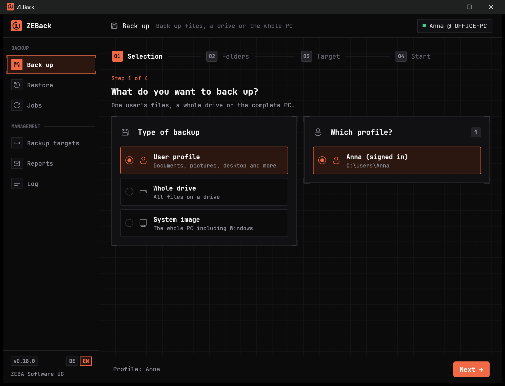
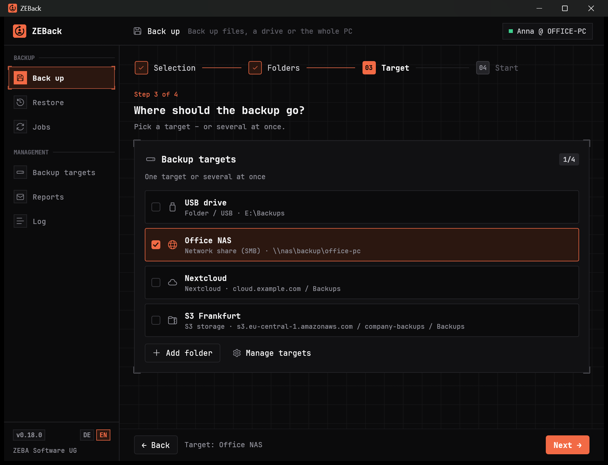
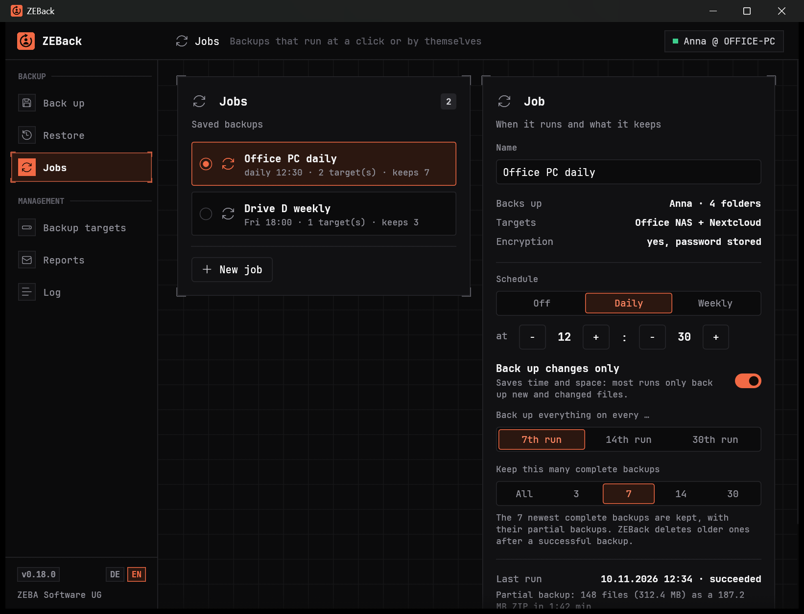
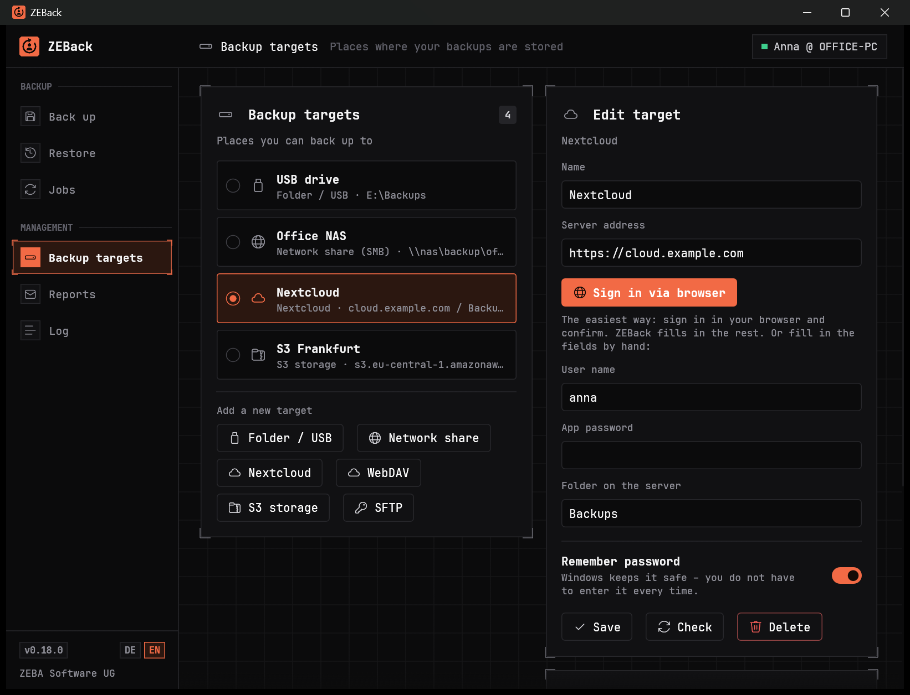
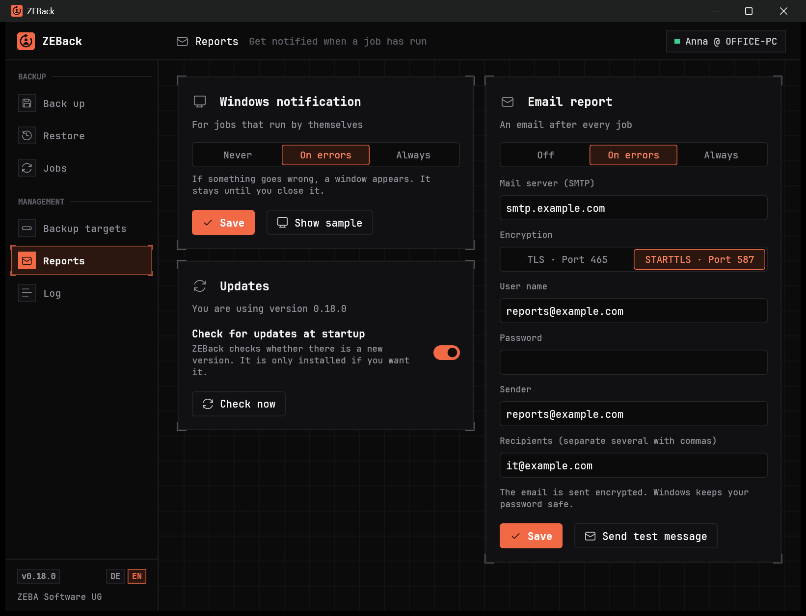

<h1 align="center">ZEBack</h1>

<p align="center">
  <b>Backup and restore for Windows – step by step, no experience needed.</b><br>
  User profiles, whole drives and complete systems. To USB, your network or the cloud.
</p>

<p align="center">
  <a href="https://github.com/ZEBA-Software/ZEBack/releases/latest"><b>⬇ Download the latest version</b></a>
  &nbsp;·&nbsp;
  <a href="#getting-started">Getting started</a>
  &nbsp;·&nbsp;
  <a href="#faq">FAQ</a>
  &nbsp;·&nbsp;
  <a href="#deutsch">Deutsch</a>
</p>

<p align="center">
  
</p>

---

## Download

All files are on the **[latest release](https://github.com/ZEBA-Software/ZEBack/releases/latest)** page.

| You want to … | Take this file |
|---|---|
| install ZEBack the usual way (recommended) | `ZEBack-<version>-x64.msi` |
| run ZEBack without installing it, e.g. from a USB stick | [`ZEBack-x64.exe`](https://github.com/ZEBA-Software/ZEBack/releases/latest/download/ZEBack-x64.exe) |
| use a device with an ARM processor (e.g. a Surface with Snapdragon) | `ZEBack-<version>-arm64.msi` or [`ZEBack-arm64.exe`](https://github.com/ZEBA-Software/ZEBack/releases/latest/download/ZEBack-arm64.exe) |

Not sure which processor you have? The **x64** version runs on almost every PC.

> **Windows shows a warning on first start?** The files are not digitally signed yet. If you see
> “Windows protected your PC”, click **More info** and then **Run anyway**.

ZEBack is made for Windows 10 and 11. If you like, it keeps itself up to date: it tells you about a
new version and installs it with one click.

## What ZEBack can do

**Back up**

- **User profile** – desktop, documents, pictures and more, plus browsers, mail and Office templates
- **Files and folders** – only the single files and folders you pick yourself, wherever they are
- **Whole drive** – all files on a drive in one ZIP file
- **System image** – a bootable image of Windows to bring back a complete PC
- **Encrypted** with AES-256 if you want – and automatically **checked** after the backup

**Where to** – one target or several at once

- USB stick, external hard drive or a folder
- Network share (NAS, server)
- Nextcloud, WebDAV, S3 storage, SFTP

**Automatically**

- **Jobs** remember what is backed up where, and run with one click or on a **schedule**
- **Back up changes only** saves time and space
- Old backups are **cleaned up** if you want
- **Reports** by email or Windows notification when something goes wrong
- Keeps running **in the background**: during a backup the window can be hidden next to the clock
  without stopping it

**Restore**

- to your user profile, back to the old place or into a folder of your choice
- whole folders or **single files**
- ZEBack finds your backups on all targets by itself

Backups of profiles and drives are ordinary ZIP files. You can get at your data even without ZEBack.

## Getting started

1. **Start ZEBack** and choose **Back up**.
2. **Pick what to back up** – your user profile is already suggested.
3. **Choose a target** – for example a folder on a USB hard drive.
4. **Start backup.** ZEBack shows how far it is, how fast it goes and how long it will take.

The window may be small: the interface adapts, and in narrow windows everything moves into one
column.

Should this run by itself from now on? In the last step choose **Save as job** and set a schedule
under **Jobs**.

ZEBack starts in English. German is one click away: **DE / EN** at the bottom of the sidebar.

## A look inside

| | |
|---|---|
| <br><sub><b>Choose a target</b> – one or several at once</sub> | <br><sub><b>Jobs</b> – schedule, partial backups, retention</sub> |
| <br><sub><b>Backup targets</b> – here a Nextcloud with sign-in via the browser</sub> | <br><sub><b>Reports and updates</b> – get notified when something is up</sub> |

## FAQ

<details>
<summary><b>Where are my passwords kept?</b></summary>

Only in the Windows Credential Manager – never in a file. The password of an encrypted backup is not
stored at all, unless you create a job that should run without asking.
</details>

<details>
<summary><b>What if I forget the password of an encrypted backup?</b></summary>

Then the backup can no longer be read – not by us either. Keep the password in a different place
than the backup.
</details>

<details>
<summary><b>How do I restore a system image?</b></summary>

A system image is restored outside the running Windows, through the Windows repair menu. ZEBack
explains the steps under <b>Restore</b> and helps you create a recovery USB stick.
</details>

<details>
<summary><b>Why does a system image take so long?</b></summary>

It contains the complete drive. Over Wi-Fi to a network drive that can take hours; with a network
cable or to a USB 3 hard drive it is much faster. For everyday use, a job for the user profile with
“Back up changes only” is usually enough.
</details>

<details>
<summary><b>What does “Back up changes only” mean?</b></summary>

After one complete backup, the job only packs new and changed files into small partial backups. At
regular intervals it makes a complete backup again. When restoring, ZEBack puts complete and partial
backups together by itself.
</details>

<details>
<summary><b>Is ZEBack available in German?</b></summary>

Yes. ZEBack starts in English; switch with <b>DE / EN</b> at the bottom of the sidebar. ZEBack
remembers your choice.
</details>

<details>
<summary><b>Can I start ZEBack from a script?</b></summary>

Yes: <code>ZEBack.exe --run-job &lt;number&gt;</code> runs a saved job without a window. The number
is shown with the job.
</details>

## Deutsch

ZEBack ist ein Programm zum Sichern und Wiederherstellen für Windows, geschrieben in Rust. Es
sichert Benutzerprofile, einzelne Dateien und Ordner, ganze Laufwerke und startfähige
Systemabbilder auf USB-Laufwerke,
Netzwerkfreigaben, Nextcloud, WebDAV, S3-Speicher und SFTP – mit Aufträgen nach Zeitplan,
Teilsicherungen, AES-256-Verschlüsselung und Berichten per E-Mail. Die Oberfläche gibt es auf
Deutsch und Englisch; sie startet auf Englisch, umschalten lässt sie sich mit **DE / EN** unten in
der Seitenleiste.
**[Neueste Version herunterladen](https://github.com/ZEBA-Software/ZEBack/releases/latest)** – nimm
die Datei `x64.msi`, außer du nutzt ein ARM-Gerät.

---

## For developers

<details>
<summary><b>Build and test</b></summary>

Requirement: [Rust](https://rustup.rs) with the targets `x86_64-pc-windows-msvc` and
`aarch64-pc-windows-msvc`.

```powershell
cargo build --release --target x86_64-pc-windows-msvc
cargo build --release --target aarch64-pc-windows-msvc
cargo test
```

The finished file is `target\<target>\release\ZEBack.exe` and needs no other files. Some tests
really touch the system (Task Scheduler, notification, browser) and only run on request:
`cargo test -- --ignored`.

Installer (MSI) – this needs the binary package of the WiX Toolset 3.14 in the folder
`tools\wix314`:

```powershell
powershell -File .\installer\build-msi.ps1
```

The script builds both architectures and puts EXE and MSI into `dist\`. With `-SkipCargo` it only
creates the installers from the existing EXE files.
</details>

<details>
<summary><b>Publishing a new version</b></summary>

1. Raise the version number in `Cargo.toml`, commit and push.
2. Create a tag with the same number and push it:

   ```powershell
   git tag v0.19.0
   git push origin v0.19.0
   ```

GitHub does the rest (`.github/workflows/release.yml`): it builds both architectures, creates the
installers and the release – with both MSI files, both EXE files and a list of checksums. If the tag
does not match the version in `Cargo.toml`, the run stops.

The text of the release is shown in the program as the description of what is new. The names of the
MSI files (`ZEBack-<version>-x64.msi`, `ZEBack-<version>-arm64.msi`) must stay as they are – the
built-in updater uses them to find the right installer.
</details>

<details>
<summary><b>Layout of the source code</b></summary>

Comments in the source code are written in German.

| File | Contents |
|---|---|
| `src/app.rs` | User interface (egui) |
| `src/backup.rs`, `src/restore.rs`, `src/verify.rs` | Backing up, restoring, checking |
| `src/jobs.rs`, `src/schedule.rs` | Jobs, schedule, clean-up, running without a window |
| `src/sysimage.rs` | System image via `wbadmin` |
| `src/nextcloud.rs`, `src/s3.rs`, `src/sftp.rs`, `src/smb.rs`, `src/remote.rs` | Backup targets on the network |
| `src/mail.rs`, `src/notify.rs`, `src/update.rs`, `src/tray.rs` | Reports, updates, icon next to the clock |
| `src/config.rs` | Settings (`%APPDATA%\ZEBack`) |
| `src/i18n.rs` | Language switch; texts are written in both languages right where they are used, with `t!` / `tr!` |
| `src/theme.rs`, `src/widgets.rs`, `src/logo.rs` | Look, controls, logo |
| `installer/` | WiX source and build script for the MSI |
</details>

## License

ZEBack is open source under the [Apache License 2.0](LICENSE) – a product of **ZEBA Software UG**.

You may use, change and share the program, also in your own projects. Two things apply:

- **The reference to ZEBA Software UG stays.** Anyone who passes on ZEBack or a changed version must
  include the [NOTICE](NOTICE) file and the copyright notices, and must mark their changes.
- **The names are not part of the license.** “ZEBack” and “ZEBA Software” may not be used as the
  name of a changed version – only to point to where it comes from.

The interface uses the font [JetBrains Mono](https://www.jetbrains.com/lp/mono/) under the SIL Open
Font License 1.1 (`assets/fonts/OFL.txt`).
